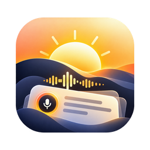

<p align="center">
  
</p>

<h1 align="center">Aube</h1>

<p align="center">A meeting recorder and note-taker for the Mac that runs on your Mac.</p>

## Features

- **Records your mic and the call separately.** "You" and "Them" each get their own live transcript, and echo cancellation keeps the call out of your mic when you use speakers.
- **Locks each speaker's language.** Aube listens to the first 30 seconds of real speech, picks the language once and sticks to it, so the transcript never flips mid-meeting.
- **Tells speakers apart.** After a call, "Them" is split into Speaker 1, 2, 3 with FluidAudio. In person, "You" is found by a voiceprint learned from your own calls. Continued recordings keep the same names.
- **Writes the summary.** Every five minutes Aube condenses what was said, then combines it into a short summary when you stop. Your own notes keep their words and stay black; generated lines are grey.
- **Push to talk from the notch.** Hold a key you choose and talk. Your words appear under the notch with a sound visualiser, and the tidied-up text is pasted into whatever app you're using.
- **Notes with history.** Write notes while recording; every line remembers when it was written and changed.
- **Search** across every transcript.
- **Your choice of model.** Summaries and push-to-talk tidying use Apple Intelligence on the Mac, or any model you run with Ollama.

## Requirements

- A Mac with Apple silicon on macOS 26 or later.
- Apple Intelligence turned on, or Ollama running locally, for summaries and tidying.
- Permission for the microphone, system audio recording and, for push to talk, Accessibility.

## Develop

```sh
bun install
bun run tauri dev
```

The first build compiles the Swift helpers and downloads the speech and speaker models, so it takes a few minutes.

## Build

```sh
APPLE_SIGNING_IDENTITY="Apple Development: Your Name (TEAMID)" bun tauri build --bundles app
```

Signing with a stable certificate keeps macOS permissions across rebuilds. The app is written to `src-tauri/target/release/bundle/macos/Aube.app`.

## Tests

```sh
cd src-tauri
cargo test              # everything
cargo test --lib speakers   # one area: speakers, summary, stt, library, mixer, tape, dictation, llm
```

## How it fits together

| Part | What it does |
| --- | --- |
| `src/` | Svelte interface |
| `src-tauri/src/` | Rust app: audio capture and mixing, transcription control, speakers, summaries, storage (SQLite) |
| `src-tauri/stt/` | Swift helper: live transcription with Apple's SpeechAnalyzer |
| `src-tauri/diarizer/` | Swift helper: speaker separation with FluidAudio |
| `src-tauri/notes/` | Swift helper: summaries with Apple Intelligence or Ollama |
| `src-tauri/dictate/` | Swift helper: push to talk, the notch panel and pasting |
